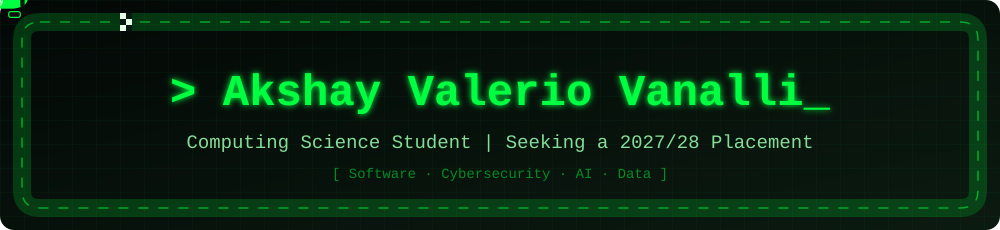

🎓 Computing Science @ <a href="https://www.ulster.ac.uk">Ulster University</a>, Belfast

## 👋 About me

- 🎓 Year 2 **BSc Computing Science** student at **[Ulster University](https://www.ulster.ac.uk)**, Belfast
- 💼 Looking for a **placement from September 2027 to June 2028**
- 🔐 Most interested in **cybersecurity** and **AI development**
- 📈 **Funded forex and commodities trader** (The5ers, Earn2Trade). I build my own trading tools
- 🌍 Bilingual: **English** and **Italian**
- 🥋 Junior Italian Champion in **kickboxing** and **K-1**

## 🛠️ Tech stack

    
  

  
  
  
  
  

## 📂 Featured projects

<table>
<tr>
<td width="50%" valign="top">

### 🌐 [Bridge AI Solutions](https://github.com/valevana/BridgeAISolutions)
Responsive, accessible business website. **Lead developer** in a team of four.

[Live demo →](https://valevana.github.io/BridgeAISolutions/CW2ClientSide/)

</td>
<td width="50%" valign="top">

### 🥷 [Ninja Platformer](https://github.com/valevana/ninja-platformer)
Solo 3-level action platformer with kunai and sword combat, a HUD, explosive traps and pickups.

 &nbsp;

[Watch demo →](https://youtu.be/xAeYd5SrkoY)

</td>
</tr>
</table>

<table>
<tr>
<td width="100%" valign="top">

### 📈 Trading Signal Tool *(private)*
Buy/sell signal indicator, **backtested over 12 months** on gold, silver, major forex pairs and US indices (S&P 500, Nasdaq, Dow Jones).

 

</td>
</tr>
</table>

